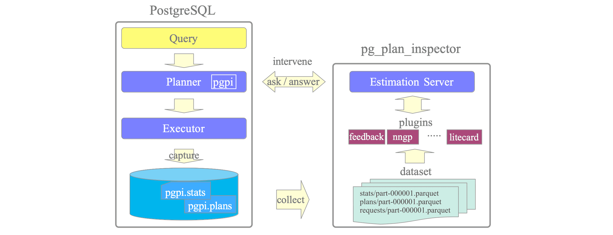

# pg_plan_inspector

`pg_plan_inspector` is a research framework for cardinality estimation in PostgreSQL. It focuses on Adaptive Query Optimization (AQO): correcting future estimates with execution telemetry from past queries.

Testing a new estimator in a production query planner takes heavy plumbing: hooking into the planner, recording actual row counts, and measuring the effect on plans and execution times. `pg_plan_inspector` handles the plumbing. You write only the estimator:

+ **No PostgreSQL patching**: Intercepts row-count estimates at five points in the planner and feeds in the predictions of an external Python estimator. PostgreSQL's native cost model and plan search stay untouched.
+ **Real-world ground truth**: Captures executed plans with the actual row count of every node, and builds training datasets from them.
+ **Python-native plugins**: Implement a method as a simple class with `fit()` and `estimate()`. Use any tool of the Python ecosystem (e.g., Yggdrasil Decision Forests). Compare it with the bundled baselines by actual execution time.

## Contents

1. [Architecture](#1-architecture)
2. [Support](#2-support)
3. [History](#3-history)
4. [Installation](#4-installation)
5. [Quick Start](#5-quick-start)
6. [Plugins](#6-plugins)
7. [Usage](#7-usage)
8. [Documents](#8-documents)
9. [Change Log](#9-change-log)
10. [Acknowledgments](#10-acknowledgments)

## 1. Architecture

`pg_plan_inspector` consists of the extension **pgpi**, which runs inside PostgreSQL, and a Python client (the estimation server and various tools), which runs outside it.



- **pgpi extension**: Captures executed plans with actual row counts and queries the estimation server whenever the planner needs row-count estimates (intervention).
- **Python client**: Collects captured plans into a dataset, trains plugin estimators, and acts as the estimation server answering extension requests.

The following subsections follow the core cycle: **capture** and **collect**, **learn**, **intervene**, and **evaluate**.

### 1.1. Capture and Collect: Dataset

When `pgpi.log_plans` is enabled, the extension captures every executed statement. It runs the statement under `EXPLAIN (ANALYZE, TIMING OFF)`, which collects the actual row count of each node without timing overhead. The plans go to `pgpi.plans`, the planning statistics to `pgpi.stats`.

A query is never blocked by this. Captured plans are first buffered in a shared-memory ring buffer (a fixed-size queue in memory), and a background worker flushes them to the `pgpi.log_database` database.

The client (`python3 -m pgpi collect`) aggregates these logs into a Parquet dataset. It appends only new changes, so the dataset grows smoothly during operation. It can also generate anonymized datasets, with obfuscated table and column names.

> **Note:** The current implementation collects datasets **manually, not automatically**.

### 1.2. Learn: Plugin

Train row-count estimators (feedback, HRES, LiteCard, NNGP, etc.) on the collected dataset, then let them intervene in the PostgreSQL planner.

Methods are implemented as Python plugins. At startup, the estimation server trains the plugins on the dataset and serves the requests of the extension.

Only the method itself needs implementing to join the capture–collect–learn–intervene–evaluate cycle. That makes `pg_plan_inspector` a full-fledged R&D framework. The bundled plugins are listed in [6. Plugins](#6-plugins).

### 1.3. Intervene: What Can Be Changed

pgpi changes one thing: the row counts and selectivities estimated by the planner. The cost model, cost parameters and plan search stay untouched. PostgreSQL still enumerates join orders, join methods and scans, and picks the cheapest plan by its native cost model, now fed with corrected row counts.

> **Note:** The current implementation omits direct plan-level intervention, but future integration with `pg_plan_advice` is planned.

#### Intervention Points

The planner estimates row counts at five places. At each point, pgpi asks the estimator and substitutes the answer for PostgreSQL's native estimate:

| Point | What the planner estimates | What it decides |
|---|---|---|
| `base` | Rows of a single table after local predicates (e.g., `orders WHERE status = 'open'`) | All operations built on the table: join orders, join methods, and parent join estimates |
| `join` | Rows of a multi-table join under applicable conditions (computed once per table set and reused across join orders) | Join orders, join methods of higher joins, and subsequent operations (aggregations, sorts) |
| `param_base` | Rows per execution of an inner-side table scanned with an outer row (nested loop index lookups) | Index nested loop cost versus hash or merge join |
| `param_join` | Same as above, for an inner-side join | Same as above |
| `clauselist` | Selectivity of a predicate list on a single table during index path costing | Index scan, bitmap scan, sequential scan, and index selection |

Each request carries the context the planner saw: the intervention point, tables (aliases and relations), predicates (as SQL text), join type, PostgreSQL's native value, and the input relations of joins ([6.4](#64-dataset-format)).

The estimator answers with a row count, a factor or a selectivity. It may also abstain, and PostgreSQL's value is used. Within one planning phase, identical queries get identical answers.

**Excluded from intervention:** base points of non-plain tables (subqueries, CTEs, functions, `VALUES`), group counts of `GROUP BY` and `DISTINCT`, and final costs.

#### Routes: How pgpi Intercepts

pgpi reaches the intervention points by two routes.

**H (Hook) Route**: official PostgreSQL planner hooks.
- `set_rel_pathlist_hook` (`base`): called after table paths are generated. It replaces the row counts of the table and its paths. Scan costs are already computed from PostgreSQL's original estimate. All higher-level operations use the estimator's answer.
- `joinrel_setup_hook` (`join`): called when a join relation is created, right after PostgreSQL estimates its size and before any join path is built.

**D (Detour) Route**: at startup, pgpi overwrites the entries of five core planner functions with jumps to its own wrappers. A wrapper runs the original function, then queries the estimator. The patch is applied once in the postmaster and inherited by all backends.

| Replaced Function | Point | Note |
|---|---|---|
| `set_baserel_size_estimates` | `base` | Executed before table paths are generated, ensuring scan costs also use the corrected estimate |
| `set_joinrel_size_estimates` | `join` | — |
| `get_parameterized_baserel_size` | `param_base` | — |
| `get_parameterized_joinrel_size` | `param_join` | — |
| `clauselist_selectivity_ext` | `clauselist` | Limited to single-table predicate lists outside outer joins. Internal calls from the four functions above bypass this |

When both routes cover a point, the D Route takes precedence. The D Route works only on Linux (`x86_64`, `ARM64`), because macOS restricts runtime code patching. Unsupported functions fall back to the H Route (or stay un-intervened). `SELECT * FROM pgpi_status()` shows the active function replacements.

#### Modes

The operation mode is controlled by the `pgpi.mode` configuration parameter:

- **`off`** (default): `pgpi` is disabled and performs no intervention.
- **`enforce`**: `pgpi` actively intervenes in query planning using estimator predictions.
- **`shadow`**: `pgpi` queries the estimator and logs the answers without applying them. Plans stay unchanged, so the evaluation is safe.

#### Hooks for Capture

Capture ([1.1](#11-capture-and-collect-dataset)) does not modify plans. It uses these hooks:

- `planner_setup_hook`, `planner_shutdown_hook`: bind planning requests to their resulting plans.
- `create_upper_paths_hook`: tracks query levels.
- `ExecutorStart_hook`, `ExecutorRun_hook`, `ExecutorFinish_hook`, `ExecutorEnd_hook`: record the actual row counts of nodes and save plans.

### 1.4. Evaluate

Estimators are evaluated primarily by execution time: the captured execution times of identical queries with and without intervention are compared (see (4) in [5.2](#4-evaluate)).

The planner still picks plans by PostgreSQL's cost model. So more accurate row counts give faster execution only when the cost model matches the hardware and the data distribution. That is why the Quick Start recommends tuning `random_page_cost` for cached workloads.

**q-error** compares estimated and true row counts offline. It is max(estimate / actual, actual / estimate): an estimate off by 10 times, over or under, has q-error 10. Accurate estimates do not guarantee better plans. So q-error is a tool for the first development and screening of an estimator, not for the final performance validation.

## 2. Support

- **PostgreSQL:** PostgreSQL 19
- **OS:** Linux and macOS
- **CPU:** x86_64 and ARM64
- **Python:** 3.10 or later (for the client)

> **Note on macOS:** The extension builds on macOS. The D Route ([1.3](#13-intervene-what-can-be-changed)) is unavailable there because of platform restrictions, so it runs via the H Route only. The Python client works fully on macOS.

## 3. History

`pg_plan_inspector` 1.x, first released in 2021, was a broad framework for applying AI to several DBMS problems: from query optimization to automated tuning and failure root-cause analysis.

By 2026, AI has evolved faster than expected. General-purpose LLMs now infer failure root causes directly from raw telemetry. Cardinality estimation, meanwhile, remains one of the few areas where specialized AI is yet to be robustly solved.

So version 1.x is frozen in the `v1` branch (tag `v1-final`). `pg_plan_inspector` 2.x focuses entirely on advancing the query planner with AI.

In this refactoring, the runtime query tree monitoring component (`pg_query_plan`) was spun off into a separate project: [pg_query_plan](https://github.com/s-hironobu/pg_query_plan).

## 4. Installation

PostgreSQL 19 must be installed, with `pg_config` in your PATH.

```sh
git clone https://github.com/s-hironobu/pg_plan_inspector
cd pg_plan_inspector
```

### 4.1. PostgreSQL Extension

The build commands depend on the CPU architecture.

#### 4.1.1. x86_64

```sh
cd extension
make PG_CONFIG=/path/to/pg_config
make PG_CONFIG=/path/to/pg_config install
```

#### 4.1.2. ARM64

```sh
cd extension
make PG_CONFIG=/path/to/pg_config PGPI_ARCH=arm64
make PG_CONFIG=/path/to/pg_config PGPI_ARCH=arm64 install
```

+ `PGPI_ARCH` defaults to the architecture of the build machine. When building locally, it can be omitted.
+ `PGPI_ARCH=none` builds the extension without the D Route. This is the default on macOS.

### 4.2. PostgreSQL Configuration

Add these settings to `postgresql.conf` and restart PostgreSQL:

```
shared_preload_libraries = 'pgpi'
pgpi.log_database = 'testdb'          # database holding the log tables (default: postgres)
```

The log tables (`pgpi.plans` and `pgpi.stats`) are created automatically in the log database.

Then enable the extension in each database where you capture queries or intervene:

```sql
CREATE EXTENSION pgpi;
SELECT * FROM pgpi_status();     -- `installed = t` for each D Route function: the patching succeeded
```

### 4.3. Python Client

The client package is in `client/pgpi/` and runs in place. Install its dependencies:

```sh
pip install "pyarrow>=14" "psycopg>=3.1" "numpy>=1.22"
pip install torch                      # Only for PyTorch-based estimators (e.g., grasp)
pip install sqlglot scikit-learn       # For LiteCard (SQL parsing and tree models)
pip install ydf                        # Optional for LiteCard: Yggdrasil Decision Forests (x86_64 and macOS only)
```

On arm64 Linux, ydf has no package. Build it from source: see [ydf on arm64 Linux](https://www.interdb.jp/blog/pgsql/ydf_on_arm64_linux/).

Run the client commands as `python3 -m pgpi <command>` from the `client/` directory:

```sh
cd client
python3 -m pgpi --help
```

## 5. Quick Start

This section walks through the core workflow: **capture, collect, learn and intervene, and evaluate**. The example is the `shop` schema in `demo/`.

### 5.1. Prepare the Sample Data

`shop` is a small schema with two classic traps for PostgreSQL's cardinality estimator:

- **Correlated columns**: `customers.region` and `customers.segment` carry the same information (so do `products.category` and `products.brand`). PostgreSQL assumes the columns are independent. For `region = 'r10' AND segment = 's10'` it estimates 1/400 of the customers. The true selectivity is 1/20.
- **Data skew**: 40% of the orders belong to customers in region `r0`. 40% of the line items belong to products in category `c0`.

| Table | Rows |
|---|---|
| `shop.customers` | 50,000 |
| `shop.products` | 5,000 |
| `shop.orders` | 500,000 |
| `shop.lineitems` | 1,500,000 |

Load the schema into the `pgpi.log_database` database (about one minute):

```sh
export DSN="host=localhost user=postgres dbname=testdb"   # must match pgpi.log_database
psql "$DSN" -f demo/shop.sql
```

The workload is in `demo/` (10 queries per template):

- `train.sql`: 40 training queries in four templates (T1–T4). They join two to four tables, using the correlated predicates above (literals `r0`–`r9`, `c0`–`c9`).
- `test.sql`: 100 evaluation queries:
  - T1–T4: the training templates with unseen literals (`r10`–`r19`, `c10`–`c19`).
  - T5–T10: unseen templates: date ranges, age/price ranges, `GROUP BY`, `IN` lists, `EXISTS` (semi-joins), and contradictory predicates that yield zero rows.

The walkthrough traces a 4-way join query of template T3:

```sql
SELECT count(*) FROM shop.customers c JOIN shop.orders o ON o.customer_id = c.id
  JOIN shop.lineitems l ON l.order_id = o.id JOIN shop.products p ON p.id = l.product_id
WHERE c.region = 'r10' AND c.segment = 's10' AND p.category = 'c10' AND p.brand = 'b10';
```

The join produces 541 rows. Native PostgreSQL (with `random_page_cost = 1.1`, see 5.2) produces this plan:

```
 Aggregate  (cost=1142.62..1142.63 rows=1 width=8)
   ->  Nested Loop  (cost=6.74..1142.61 rows=2 width=0)
         ->  Nested Loop  (cost=6.45..954.57 rows=600 width=4)
               ->  Nested Loop  (cost=6.02..688.76 rows=600 width=4)
                     ->  Bitmap Heap Scan on products p  (cost=2.13..31.63 rows=2 width=4)
                           Recheck Cond: (category = 'c10'::text)
                           Filter: (brand = 'b10'::text)
                           ->  Bitmap Index Scan on products_category_idx  (cost=0.00..2.13 rows=100 width=0)
                                 Index Cond: (category = 'c10'::text)
                     ->  Bitmap Heap Scan on lineitems l  (cost=3.89..325.51 rows=305 width=8)
                           Recheck Cond: (product_id = p.id)
                           ->  Bitmap Index Scan on lineitems_product_id_idx  (cost=0.00..3.82 rows=305 width=0)
                                 Index Cond: (product_id = p.id)
               ->  Index Scan using orders_pkey on orders o  (cost=0.42..0.44 rows=1 width=8)
                     Index Cond: (id = l.order_id)
         ->  Index Scan using customers_pkey on customers c  (cost=0.29..0.31 rows=1 width=4)
               Index Cond: (id = o.customer_id)
               Filter: ((region = 'r10'::text) AND (segment = 's10'::text))
```

PostgreSQL multiplies the selectivities of `category` and `brand`. It expects only 2 matching products (instead of about 100) and 2 final rows (instead of 541). So it drives the plan from `products`, with nested loops across `lineitems`, `orders` and `customers`.

### 5.2. Basic workflow

All steps set `random_page_cost = 1.1`, because the dataset fits in memory and storage is cached. With the default, disk-oriented value, more accurate row counts can produce slower plans on cached data.

#### (1) Capture

Run the training workload (`train.sql`) with native PostgreSQL, without intervention. This captures execution plans and actual row counts. (`test.sql` is reserved for step (4).)

Capturing needs superuser privileges, or explicit permission on the parameter (`GRANT SET ON PARAMETER pgpi.log_plans TO ...`).

```sh
psql "$DSN" -q -o /dev/null \
     -c "SET pgpi.log_plans = on" -c "SET random_page_cost = 1.1" \
     -c "SET pgpi.label = 'train'" -f demo/train.sql \
     -c "SELECT pgpi_log_flush()"
```

A background worker flushes the captured plans to `pgpi.plans` asynchronously ([1.1](#11-capture-and-collect-dataset)). `pgpi_log_flush()` blocks until all pending records are persisted.

`pgpi_log_flush()` is itself captured under the same label. That is why the evaluation query in step (4) filters it out.

#### (2) Collect

Export the captured plans into a Parquet dataset. At this point it holds only the training workload.

```sh
cd client
python3 -m pgpi collect --dsn "$DSN" --out ds/        # append the captured plans to a Parquet dataset (incremental)
python3 -m pgpi info --data ds/                       # summary of the contents
```

#### (3) Learn and intervene

In a separate terminal, start the estimation server. At startup, it trains the selected plugin on `ds/`. The example uses `feedback`, a lightweight AQO baseline with no PyTorch dependency.

```sh
cd client                                  # where ds/ was created in (2)
python3 -m pgpi serve --socket /tmp/pgpi.sock --dsn "$DSN" --plugin feedback --data ds/ --verbose
```

In psql, point the extension to the server socket and enable enforce mode. The planner then uses the predictions of the estimator:

```sql
SET random_page_cost = 1.1;
SET pgpi.callback = '/tmp/pgpi.sock';
SET pgpi.mode = enforce;
EXPLAIN SELECT count(*) FROM shop.customers c JOIN shop.orders o ON o.customer_id = c.id
  JOIN shop.lineitems l ON l.order_id = o.id JOIN shop.products p ON p.id = l.product_id
WHERE c.region = 'r10' AND c.segment = 's10' AND p.category = 'c10' AND p.brand = 'b10';
```

```
 Finalize Aggregate  (cost=14622.83..14622.84 rows=1 width=8)
   ->  Gather  (cost=14622.61..14622.82 rows=2 width=8)
         Workers Planned: 1
         ->  Partial Aggregate  (cost=13622.61..13622.62 rows=1 width=8)
               ->  Hash Join  (cost=399.42..13620.80 rows=725 width=0)
                     Hash Cond: (l.product_id = p.id)
                     ->  Nested Loop  (cost=366.51..13492.65 rows=36252 width=4)
                           ->  Hash Join  (cost=366.09..6831.39 rows=12084 width=4)
                                 Hash Cond: (o.customer_id = c.id)
                                 ->  Parallel Seq Scan on orders o  (cost=0.00..5693.18 rows=294118 width=8)
                                 ->  Hash  (cost=333.19..333.19 rows=2632 width=4)
                                       ->  Bitmap Heap Scan on customers c  (cost=23.56..333.19 rows=2632 width=4)
                                             Recheck Cond: (region = 'r10'::text)
                                             Filter: (segment = 's10'::text)
                                             ->  Bitmap Index Scan on customers_region_idx  (cost=0.00..22.90 rows=2575 width=0)
                                                   Index Cond: (region = 'r10'::text)
                           ->  Index Scan using lineitems_order_id_idx on lineitems l  (cost=0.43..0.52 rows=3 width=8)
                                 Index Cond: (order_id = o.id)
                     ->  Hash  (cost=31.66..31.66 rows=100 width=4)
                           ->  Bitmap Heap Scan on products p  (cost=2.16..31.66 rows=100 width=4)
                                 Recheck Cond: (category = 'c10'::text)
                                 Filter: (brand = 'b10'::text)
                                 ->  Bitmap Index Scan on products_category_idx  (cost=0.00..2.13 rows=100 width=0)
                                       Index Cond: (category = 'c10'::text)
```

The row-count estimates are now close to reality:

| | PostgreSQL alone | enforce | actual |
|---|---|---|---|
| `products p` | 2 | 100 | about 100 |
| `customers c` | (filtered inside an index scan) | 2632 | about 2,500 |
| result of the joins | 2 | 725 | 541 |

The estimator never saw the literals `r10` or `c10` in training. It still learned PostgreSQL's systematic underestimation pattern for this template.

With realistic cardinalities, the planner switches to a completely different strategy: a hash join of `customers` and `orders`, a nested loop to `lineitems`, and a hash join with `products` last.

pgpi never dictates join orders or operators. It only supplies corrected row counts to PostgreSQL's native planner.

The collected dataset also supports deeper analysis: why a method was slower or faster, down to a single node of a plan. See [benchmark/ANALYSIS.md](./benchmark/ANALYSIS.md) for worked examples.

#### (4) Evaluate

To measure the end-to-end effect, run `test.sql` back to back under both modes (to keep the buffer cache comparable) and compare the total execution times.

First, the baseline without intervention:

```sh
psql "$DSN" -q -o /dev/null \
     -c "SET pgpi.log_plans = on" -c "SET random_page_cost = 1.1" \
     -c "SET pgpi.mode = off" \
     -c "SET pgpi.label = 'test-original'" -f demo/test.sql \
     -c "SELECT pgpi_log_flush()"
```

Next, the same workload with the estimation server in enforce mode:

```sh
psql "$DSN" -q -o /dev/null \
     -c "SET pgpi.log_plans = on" -c "SET random_page_cost = 1.1" \
     -c "SET pgpi.callback = '/tmp/pgpi.sock'" -c "SET pgpi.mode = enforce" \
     -c "SET pgpi.label = 'test-enforce'" -f demo/test.sql \
     -c "SELECT pgpi_log_flush()"
```

Then compare the aggregated execution times:

```sql
SELECT label, count(*), round(sum(execution_ms)) AS ms
FROM pgpi.plans WHERE label IN ('test-original', 'test-enforce')
  AND query NOT LIKE '%pgpi_log_flush%'
GROUP BY label;
```

Example output:

```
     label     | count |  ms
---------------+-------+------
 test-enforce  |   100 | 3698
 test-original |   100 | 4690
(2 rows)
```

The total execution time of the 100 test queries drops from 4,690 ms to 3,698 ms (about 21% faster). Each query takes tens of milliseconds on this small cached dataset. Run each configuration several times to account for run-to-run variance before drawing conclusions.

#### Trying Other Plugins

To evaluate another estimator, replace `feedback` in step (3) with another plugin, such as `hres` or the PyTorch-based `grasp` (see [6. Plugins](#6-plugins)).

#### Closing the Learning Loop

Finally, collect the newly captured test executions into `ds/`. A later restart of the server can then learn from them. This completes the continuous AQO feedback cycle:

```sh
python3 -m pgpi collect --dsn "$DSN" --out ds/
```

> **Note:** In the current implementation, newly collected data takes effect only after restarting the estimation server.

```sh
python3 -m pgpi serve --socket /tmp/pgpi.sock --dsn "$DSN" --plugin feedback --data ds/ --verbose
fitted feedback on ds/
pgpi server listening on /tmp/pgpi.sock with ['feedback']

^C
python3 -m pgpi serve --socket /tmp/pgpi.sock --dsn "$DSN" --plugin feedback --data ds/ --verbose
```

### 5.3. Demo and Benchmarks

`demo/run.py` automates this whole Quick Start for all bundled plugins on the shop workload. It reports execution time and q-error separately for seen templates (T1–T4) and unseen templates (T5–T10) (see [demo/README.md](demo/README.md)):

```sh
python3 demo/run.py --dsn "$DSN" --quick
```

The `benchmark/` directory runs the same comparison on three standard research workloads: a subset of STATS-CEB, JOB-light, and template 1a of CEB-IMDb (see [benchmark/README.md](benchmark/README.md)):

```sh
python3 benchmark/stats_ceb/run.py --dsn "$DSN"
```

The dataset that a benchmark collects can be analyzed further, to see why a method was slower or faster. [benchmark/ANALYSIS.md](./benchmark/ANALYSIS.md) shows how, with worked examples.

## 6. Plugins

Estimators are loaded as plugins. Ten are bundled: seven estimation methods and three evaluation baselines.

Each bundled plugin is one file in `client/pgpi/estimator_plugins/`. The file name replaces hyphens with underscores (e.g., `ce-feedback` is `ce_feedback.py`). Bundled plugins use the same API as custom plugins, so they serve as reference implementations.

Pass a plugin with `--plugin` to `python3 -m pgpi serve` and related commands. Parameters follow the name: `name:key=value,key=value` (e.g., `matcomp:rank=3`).

### 6.1. Methods

| Name | Method Description | Reference |
|---|---|---|
| `feedback` | Corrects estimates using execution feedback: observed rows for previously seen queries, otherwise a query-template-specific correction factor (for joins, applied to the join's own selectivity) | (This project; inspired by LEO) |
| `hres` | Hierarchical residuals applied to PostgreSQL's native estimate strictly up to the level of proven certainty | (This project) |
| `matcomp` | Formulates join cardinality estimation as matrix completion over join keys | (This project) |
| `ce-feedback` | Per-query switching of model assumptions, similar to SQL Server's CE feedback | [SQL Server](https://learn.microsoft.com/en-us/sql/relational-databases/performance/intelligent-query-processing-cardinality-estimation-feedback) |
| `litecard` | LiteCard estimator | [Yi et al., 2025](https://arxiv.org/abs/2510.03386) |
| `nngp` | Neural Network Gaussian Process (NNGP) | [Zhao et al., SIGMOD 2022](https://arxiv.org/abs/2107.08706) |
| `grasp` | GRASP *(requires PyTorch)* | [Wu et al., PVLDB 2025](https://www.vldb.org/pvldb/vol18/p2519-wu.pdf) |

No method reads raw table data. They rely only on captured execution plans and PostgreSQL's statistics (`pg_statistic`, recorded in the dataset by the `pgpi` extension).

The published methods are `pgpi`'s independent re-implementations, based strictly on their papers. No author code was used. They diverge where necessary, for instance by learning from executed plan nodes. How each method works, and how it differs from its paper, is described in [`client/pgpi/estimator_plugins/README.md`](client/pgpi/estimator_plugins/README.md) and at the top of each plugin file. For `litecard` and `nngp`, the defaults of the original papers are modifiable constants at the top of their source files.

#### References:

- **grasp**: Peizhi Wu et al. "Data-Agnostic Cardinality Learning from Imperfect Workloads." PVLDB 18(8), 2025. [[PDF](https://www.vldb.org/pvldb/vol18/p2519-wu.pdf), [arXiv:2506.16007](https://arxiv.org/abs/2506.16007)]
- **ce-feedback**: Microsoft. "[Cardinality estimation (CE) feedback](https://learn.microsoft.com/en-us/sql/relational-databases/performance/intelligent-query-processing-cardinality-estimation-feedback)"; Microsoft. "[Cardinality Estimation (SQL Server)](https://learn.microsoft.com/en-us/sql/relational-databases/performance/cardinality-estimation-sql-server)"; Joseph Sack. "[Optimizing Your Query Plans with the SQL Server 2014 Cardinality Estimator](https://learn.microsoft.com/en-us/previous-versions/dn673537%28v=msdn.10%29)." Microsoft white paper, 2014.
- **litecard**: Zixuan Yi et al. "[Is it Bigger than a Breadbox: Efficient Cardinality Estimation for Real World Workloads](https://arxiv.org/abs/2510.03386)." 2025. Uses [Yggdrasil Decision Forests](https://github.com/google/yggdrasil-decision-forests) (Guillame-Bert et al., KDD 2023) for tree learning and [sqlglot](https://github.com/tobymao/sqlglot) for SQL parsing, as specified in the paper.
- **nngp**: Kangfei Zhao et al. "Lightweight and Accurate Cardinality Estimation by Neural Network Gaussian Process." SIGMOD 2022. [[arXiv:2107.08706](https://arxiv.org/abs/2107.08706)]
- **feedback**: Adapts the query-feedback correction principle introduced by Michael Stillger et al. in "[LEO – DB2's LEarning Optimizer](https://research.ibm.com/publications/leo-db2s-learning-optimizer)" (VLDB 2001).

### 6.2. Baselines

| Name | Description |
|---|---|
| `postgres` | Always abstains, returning PostgreSQL's native estimate (used as the primary control baseline) |
| `oracle` | Executes `COUNT(*)` to return true row counts (strictly for evaluation yardsticks) |
| `truecard` | Returns observed true row counts directly for matching requests |

### 6.3. Writing Your Own Plugin

To build a custom estimator, subclass `pgpi.Estimator` and implement `fit()` (training) and `estimate()` (serving requests). A template is in `client/pgpi/estimator_plugins/example/my_estimator.py`. Simple bundled examples are `postgres.py` (minimal), `truecard.py` and `feedback.py`. The structure `fit()` receives is described in [6.4](#64-dataset-format).

```python
import pgpi

class MyEstimator(pgpi.Estimator):
    name = "mine"

    def fit(self, dataset):            # dataset.examples(): the request (ex.request), true rows, PostgreSQL's estimate
        ...

    def estimate(self, req):           # return None to abstain (PostgreSQL's value is used)
        return pgpi.rows(1000)         # or pgpi.factor(2.0); pgpi.sel(0.01) for clauselist
```

Reference the plugin as `file:class` to pass it to the estimation server and the evaluation tools:

```sh
python3 -m pgpi serve --plugin pgpi/estimator_plugins/example/my_estimator.py:MyEstimator --data ds/ --socket /tmp/pgpi.sock     # in client/
```

### 6.4. Dataset format

A dataset made by `python3 -m pgpi collect` is a directory of Parquet files with four tables: `dataset.plans`, `dataset.nodes`, `dataset.requests` and `dataset.stats`. Load them with `pgpi.Dataset`, or query them with DuckDB. Most estimators work with `ds.examples()`, which yields one `pgpi.Example` per usable plan node.

The columns of the tables, `pgpi.Example` and `pgpi.Request` are in [client/pgpi/DATASET.md](./client/pgpi/DATASET.md).

## 7. Usage

### 7.1. PostgreSQL Extension

#### 7.1.1. Routes and Intervention Points

The estimator is queried at each point where the planner estimates a row count (an intervention point). It uses one of two routes ([1.3](#13-intervene-what-can-be-changed)):

- **H Route (Hook)**: official PostgreSQL 19 hooks.
- **D Route (Detour)**: replaces the entry points of internal size-estimation functions at startup (supported on Linux for x86_64 and ARM64).

| Point | Description | H Route | D Route (Replaced Function) |
|---|---|---|---|
| `base` | Row count of a base table | `set_rel_pathlist_hook` | `set_baserel_size_estimates` |
| `join` | Row count of a join relation | `joinrel_setup_hook` | `set_joinrel_size_estimates` |
| `param_base` | Rows per loop of a parameterized base table | None | `get_parameterized_baserel_size` |
| `param_join` | Rows per loop of a parameterized join relation | None | `get_parameterized_joinrel_size` |
| `clauselist` | Selectivity of a clause list on a single table (e.g., for index costing) | None | `clauselist_selectivity_ext` |

When both routes cover an intervention point, the D Route takes precedence, because it runs earlier.

Answers are resolved in this order: directives (`pgpi.directives`), then the estimation server (`pgpi.callback`). If neither answers, PostgreSQL's native estimate is used.

#### 7.1.2. Parameters

##### GUCs for Intervention

| GUC | Default | Description |
|---|---|---|
| `pgpi.mode` | `off` | Operation mode: `off`, `shadow` (query and log answers only), or `enforce` (apply answers) |
| `pgpi.enable_hook` | `on` | Enable the H Route |
| `pgpi.enable_detour` | `on` | Enable the D Route (restricted to successfully replaced functions) |
| `pgpi.detour_clauselist` | `on` | Enable the replacement of `clauselist_selectivity_ext` |
| `pgpi.directives` | `''` | Static answer directives (see below) |
| `pgpi.callback` | `''` | UNIX socket path of the estimation server |
| `pgpi.callback_timeout` | `2000ms` | Round-trip timeout per request. On failure, the backend suspends queries for 5 seconds and falls back to PostgreSQL values |
| `pgpi.hints` | `''` | Hints passed to the estimator alongside each request |
| `pgpi.trace` | `off` | Emits a NOTICE for each intervention request |
| `pgpi.log_size` | `1000` | Number of requests retained per backend (`pgpi_requests()`) |

Directives specify exact row counts without an estimation server. Relations are referenced by alias, in any order:

```text
ROWS(t1 t2)=10000;    SCALE(t1)=100;          -- base / join
PROWS(f | d)=99897;   PSCALE(f | d)=1000;     -- param_base / param_join (target | outer)
SEL(f | d)=0.05                                -- clauselist
```

##### GUCs for Capture

| GUC | Default | Description |
|---|---|---|
| `pgpi.log_plans` | `off` | Enable execution plan capture (requires superuser or `GRANT SET ON PARAMETER`) |
| `pgpi.log_sample_rate` | `1.0` | Fraction of statements captured (decided uniformly per statement across planning, execution, and nested levels) |
| `pgpi.log_min_duration` | `0` | Capture only statements taking at least this many milliseconds |
| `pgpi.log_nested` | `off` | Capture statements executed inside functions |
| `pgpi.log_explain` | `on` | Save detailed `EXPLAIN (ANALYZE, TIMING OFF, SETTINGS, FORMAT JSON)` output |
| `pgpi.log_requests` | `matched` | Scope of captured plan requests (`none` / `matched` / `all`) |
| `pgpi.log_stats` | `on` | Capture statistics versions and persist contents of newly encountered versions |
| `pgpi.log_parameters` | `on` | Save bind parameter values |
| `pgpi.log_canceled` | `on` | Capture statements aborted by `statement_timeout` or manual cancellation |
| `pgpi.label` | `''` | User label attached to requests and execution logs |
| `pgpi.log_database` | `postgres` | Target database for log tables (requires restart) |
| `pgpi.log_buffer_size` | `16MB` | Size of the shared-memory ring buffer (requires restart) |
| `pgpi.log_retention` | `0` | Retention window for plans in minutes (`0` = keep indefinitely) |
| `pgpi.log_max_rows` | `0` | Maximum limit on plan rows (`0` = unlimited) |
| `pgpi.stats_max` | `10000` | Maximum remembered statistics versions as "already saved" (requires restart) |

#### 7.1.3. SQL Functions

- `pgpi_requests()`: Returns the request/answer log for the current backend (route, point, rels, outer_rels, pg_value, answer, source, applied, request, query).
- `pgpi_clear()`: Clears the request log for the current backend.
- `pgpi_status()`: Reports patching status and call counts for each D Route function.
- `pgpi_log_flush(timeout_ms DEFAULT 10000)`: Blocks until the background worker has written all pending logs of all backends to `pgpi.plans` and `pgpi.stats`. Returns `true` on success, or `false` on timeout or if pgpi is not initialized (not preloaded). Run it before querying the log tables or running `collect` after a workload.
- `pgpi_log_status()`: Reports ring buffer statistics (entries written, dropped, etc.).
- `pgpi_stats_reset_seen()`: Resets tracking of saved statistics versions, forcing their contents to be re-persisted upon next encounter.

#### 7.1.4. Log Tables

##### Table `pgpi.plans`

Contains one row per executed statement.

| Column | Description |
|---|---|
| `seqid`, `logged_at` | Sequence number and persistence timestamp |
| `start_time`, `end_time`, `planning_ms`, `execution_ms` | Timing metrics (execution duration is measured via whole-query timers without per-node timing overhead) |
| `dbid`, `database`, `username`, `pid`, `nested_level` | Execution environment metadata |
| `queryid`, `planid` | Identifiers for grouping and comparing plans. `queryid` is PostgreSQL's internal query identifier (constants normalized so identical templates share IDs; `pgpi` automatically enables `compute_query_id`). `planid` is a structural hash of node types, tree layout, and relations |
| `status` | Execution status: `complete`, `partial` (e.g., cursors or `INTO` targets not fully fetched), or `canceled` |
| `label`, `query`, `params` | Assigned label, SQL text, and bind parameters |
| `explain` *(json)* | Core `EXPLAIN` output payload |
| `nodes` *(jsonb)* | Node-level metadata matching request formats, native estimates, actual rows, and early termination flags |
| `meta` *(jsonb)* | Range table (`rtable`: RTIs, relation identifiers, aliases, table names), subplans, statistics references (`stats_refs`), requests, and active mode |

##### Table `pgpi.stats`

Stores one row per `(dbid, relid, version)`, holding core table statistics (`pg_statistic`) and extended statistics. `meta.stats_refs` in captured plans points to the statistics versions active during planning. So an estimator can tell the states before and after `ANALYZE` apart.

### 7.2. `pgpi` Server

The estimation server loads the plugin estimators and processes the intervention requests of the extension.

```sh
python3 -m pgpi serve --socket /tmp/pgpi.sock --dsn "$DSN" --plugin hres --data ds/ [--guard K] [--guard-under U] [--log answers.jsonl] [--verbose]
```

| Option | Description |
|---|---|
| `--socket` | UNIX socket path to listen on (default: `/tmp/pgpi.sock`). Must match `pgpi.callback` |
| `--plugin` | Target estimator plugin |
| `--data` | Training dataset loaded at startup |
| `--dsn` | Connection string for estimators requiring database access (e.g., `oracle`) |
| `--guard` | Abstain if predictions exceed $K$ times above or below PostgreSQL's estimate (e.g., `--guard 10`), falling back to native estimates (disabled by default) |
| `--guard-under` | Abstain if predictions fall more than $U$ times below PostgreSQL's estimate (overrides `--guard` on underestimates; e.g., `--guard 10 --guard-under 3`). Underestimates carry higher risk (triggering excessive nested loops); disabled by default |
| `--log` | Appends requests and answers as JSON Lines |
| `--verbose` | Logs each request as `route kind (target \| outer) pg=PostgreSQL estimate -> answer [response time]` |

The extension and the estimation server communicate over the UNIX socket with newline-delimited JSON objects. Example request payload:

```json
{
  "route": "D",
  "queryid": 0,
  "label": null,
  "point": "param_base",
  "plan_name": null,
  "rels": [{"rti": 2, "alias": "f", "rel": "public.f", "relid": 24609, "inh": false}],
  "outer": [{"rti": 1, "alias": "d", "rel": "public.d", "relid": 24601, "inh": false}],
  "clauses": [{"sql": "(d.id = f.d_id)", "rels": "d f"}],
  "outer_clauses": [{"sql": "(d.cat = 'hot'::text)", "rels": "d"}],
  "opaque": 0,
  "nonrel": false,
  "jointype": 0,
  "pg": 99,
  "tuples": 2000000
}
```

An estimator answers with `{"rows": N}`, `{"factor": F}` (scales PostgreSQL's value), `{"sel": S}` (for `clauselist`), or `{}` (abstain). Join requests also carry the input split the planner uses and its row counts (`split`, `outer_rows`, `inner_rows`). Any server that follows this protocol works, so a custom estimation server can be written in a language other than Python.

### 7.3. `pgpi` Tools

| Command | Description |
|---|---|
| `python3 -m pgpi collect --dsn DSN --out DIR [--label PATTERN] [--anonymize names\|full --salt S]` | Incrementally appends new log entries to a Parquet dataset. `--label` accepts SQL LIKE patterns |
| `python3 -m pgpi info --data DIR` | Summarizes dataset contents (labels, request categories, frequencies) |
| `python3 -m pgpi anonymize --data DIR --out DIR2 --salt S [--level names\|full]` | Generates an anonymized dataset copy (`names` obscures table/column names; `full` also masks literals) |
| `python3 -m pgpi qerror --data DIR --plugin P [--fit-label L] [--label L] [--group-by point\|rels]` | Evaluates estimation accuracy offline. Supports data splitting via `--test-fraction 0.5 --split-by queryid` |
| `python3 -m pgpi cefeedback --data DIR --store hints.json [--threshold 2.0] [--tolerance 0.2]` | Executes a round of CE feedback (identifies erroneous assumptions, tests hints, and retains non-regressing hints) |

Run `python3 -m pgpi <command> --help` for all command-line options.

The helper scripts in `client/tools/` inspect a run in depth ([client/tools/README.md](client/tools/README.md)):

| Script / Command | Description |
|---|---|
| `python3 tools/qerror_runs.py --data DIR [--like PATTERN] [--by-point]` | Analyzes q-error of actual plan-used estimates per label (reports count, geometric mean, median, p90, p99, broken down by point and join size) |
| `python3 tools/qerror_by_source.py --data DIR --plugin P --fit-label L --label L [--by-size]` | Breaks down a plugin's q-error by answer source and abstention rationale |
| `python3 tools/slow_queries.py --data DIR --estimator-label LABEL [--baseline-label LABEL] [--top N]` | Lists the queries an estimator made slower than a baseline, with both plans and the estimate, actual rows and q-error of every node |
| `python3 tools/grasp_check.py --data DIR --tables T1,T2 [--fit-label L] [--label L] [--save F \| --load F]` | Splits a grasp join estimate into its factors (the count of each table and the overlap of the key sketches), each against the actual value |

These operations can also be driven from Python:

```python
import pgpi

ds = pgpi.Dataset("ds/")
est = pgpi.load("matcomp:rank=2")
est.fit(ds)
```

## 8. Documents

- [demo/README.md](./demo/README.md): the Quick Start data, and the Quick Start with every plugin
- [benchmark/README.md](./benchmark/README.md): the benchmarks (STATS-CEB, JOB-light, and CEB-IMDb 1a) and how to run them
- [benchmark/RESULTS.md](./benchmark/RESULTS.md): the results of the benchmarks
- [client/pgpi/estimator_plugins/README.md](./client/pgpi/estimator_plugins/README.md): the bundled estimators, and how they differ from the papers
- [benchmark/ANALYSIS.md](./benchmark/ANALYSIS.md): how to analyze the collected datasets, with worked examples
- [client/pgpi/DATASET.md](./client/pgpi/DATASET.md): the format of the dataset (tables, columns, `Example` and `Request`)
- [client/tools/README.md](./client/tools/README.md): the scripts that look into datasets after a run

## 9. Change Log

- 2026-11-26: pg_plan_inspector 2.0, the first release of 2.x

## 10. Acknowledgments

Much of the code and documentation of pg_plan_inspector 2.x was written with Claude (Anthropic), under the author's direction and review.


